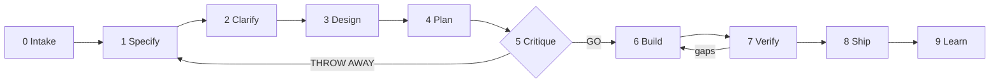

# DevBox

A spec-driven delivery harness for building software of any shape with AI coding agents.

DevBox takes a request ("build me X", "fix Y", "continue") and walks it through gated phases until it ships:
intake, specify, clarify, design, plan, critique, build, verify, ship, learn. Each phase writes one artifact to
disk and ends at a gate, so work survives context resets, hand-offs between agents, and the occasional bad idea.
It packages the best-known public methodologies (GitHub Spec Kit, obra/superpowers, Matt Pocock's skills, BMAD,
HumanLayer's context engineering, Anthropic's harness guidance, Google's engineering practices, the Twelve-Factor
App, OWASP, SRE, DORA and more) into one opinionated, tested workflow.

It ships as three things that work together:

- **A Claude Code plugin**: 17 skills (`/devbox:deliver` and the phase skills), 9 subagents (Linus the plan
  critic and his review lenses, an implementer, an independent QA), and guardrail hooks.
- **The `devbox` CLI**: scaffolds projects, tracks features through the lifecycle, runs the verify gates, and
  drives an AFK loop that builds one task per fresh agent session.
- **Playbooks and templates**: the lifecycle plus 13 core playbooks, 14 project-shape playbooks (web app to firmware), and the
  spec, design, task, ADR, threat model, runbook, postmortem and release templates. Agent-agnostic Markdown, so
  Codex, Cursor or Copilot can follow them too.

## Quick start

```bash
git clone https://github.com/Ahmadkashif/devbox ~/.devbox
~/.devbox/install.sh --plugin        # puts `devbox` on PATH and installs the Claude Code plugin
```

Or install only the plugin from inside Claude Code:

```
/plugin marketplace add Ahmadkashif/devbox
/plugin install devbox@devbox
```

(Plugin executables in `bin/` are on the Bash tool's PATH while the plugin is enabled, so skills can call
`devbox` even without the installer.)

Then, in any repository (new or existing):

```bash
devbox init --shape web-app,api-service      # stack is auto-detected; see `devbox shapes`
```

and in Claude Code:

```
/devbox:deliver build a CSV export for the reports page
```

`/devbox:deliver` reads the state on disk, picks a lane, and runs the next phase. Say "continue" in a later session
and it resumes exactly where the files say the work stands.

## The lifecycle



| Phase | Skill | Artifact | Gate |
|-------|-------|----------|------|
| Intake | `/devbox:intake` | `AGENTS.md`, `.devbox/config`, `.devbox/constitution.md` | verify gates run green; constitution adopted |
| Specify | `/devbox:spec` | `specs/NNN/spec.md` | stories with IDs and priorities, testable criteria (EARS or Given/When/Then) |
| Clarify | `/devbox:grill` | spec decisions log | zero clarification markers, **human approves** |
| Design | `/devbox:design` | `design.md`, ADRs, contracts, threat model | constitution check, one-way doors approved |
| Plan | `/devbox:slice` | `tasks.md` | vertical slices, AFK or HITL, every criterion covered |
| Critique | `/devbox:critique` | verdict in `progress.md` | **GO** from `devbox:linus` |
| Build | `/devbox:build` or `devbox run` | code, tests, commits | per task: test first, verify green, committed |
| Verify | `/devbox:verify`, `/devbox:review` | verification matrix | evidence for every criterion, independent QA passes |
| Ship | `/devbox:ship` | PR, CHANGELOG, rollout plan | CI green, **human merges** |
| Learn | `/devbox:retro` | lessons in `AGENTS.md`, playbooks, hooks | something durable changed |

Lanes scale the ceremony: a **patch** (bug fix) goes reproduce, failing test, fix, verify, ship; a **feature** runs
the table above; a **product** starts with intake and a roadmap, then runs features. Details in
[playbooks/lifecycle.md](playbooks/lifecycle.md).

## The CLI

```
devbox init [DIR] --shape S[,S] [--stack K]   install DevBox into a project (never overwrites)
devbox feature "<name>"                       start specs/NNN-name/ and make it active
devbox status                                 every feature, its phase and task progress
devbox next                                   the next open task
devbox approve spec|design|tasks|ship         pass a gate (with preconditions)
devbox verify                                 run FORMAT, LINT, TYPECHECK, TEST, BUILD gates
devbox run [--max N] [--dry-run]              AFK loop: one headless agent session per task
devbox adr "<title>"                          new ADR in docs/adr/
devbox sync | doctor | shapes | use           refresh vendored files, health check, list shapes, switch feature
```

`devbox init` writes `AGENTS.md` (the canonical instructions for every agent) and a thin `CLAUDE.md` that imports
it, `.devbox/` (config, constitution, vendored playbooks and templates, and a pinned copy of the CLI that CI uses),
`docs/architecture.md`, `docs/adr/0001`, a SHA-pinned CI workflow for the stack, PR and issue templates, Dependabot
config and `SECURITY.md`. Stacks: node, python, go, rust, jvm, dotnet, generic.

### The AFK runner

`devbox run` pipes [templates/spec/worker-prompt.md](templates/spec/worker-prompt.md) to a fresh headless agent
for each open task (default `claude -p --permission-mode auto`, configurable in `.devbox/config`; any agent CLI
that reads stdin works). It is deliberately conservative:

- refuses protected branches, dirty trees, and task lists that have not passed the critique gate;
- after every task requires the box checked, a new commit, and green verify gates;
- stops on HITL tasks, blocked tasks, failures, `.devbox/STOP`, or `--max`;
- pauses on usage or rate limits and never enables paid overage.

Exit codes: 0 done or limit reached, 1 error, 2 needs a human, 3 verify failed, 4 usage limit.

## Skills and agents

| Skill | Purpose |
|-------|---------|
| `deliver` | the conductor: orient from disk, pick the lane, run the next phase, stop at human gates |
| `intake`, `spec`, `grill`, `design`, `slice`, `critique`, `build`, `verify`, `ship`, `retro` | one per phase |
| `tdd`, `debug`, `review`, `adr`, `architecture`, `humanize` | helpers used inside phases |

| Agent | Role |
|-------|------|
| `linus` | adversarial plan critic: triages lenses, dispatches them serially, self-verifies, returns GO or THROW AWAY with a three-line case |
| `frontend-lens`, `backend-lens`, `infra-lens`, `ai-lens`, `security-lens` | domain reviewers with a six-step pipeline and dry-runs; only verified CRITICAL and MAJOR findings |
| `verification-lens` | confirms, refutes, upgrades or objects to every finding against the source; checks coverage |
| `implementer` | one task, test first, fresh context; reports DONE, DONE_WITH_CONCERNS, NEEDS_CONTEXT or BLOCKED |
| `qa` | independent acceptance testing of the running system, PASS or FAIL per criterion with evidence |

## Guardrail hooks

Active wherever the plugin is enabled. They are a seatbelt, not a sandbox; run fully unattended agents in a
container or VM.

- **SessionStart**: inside a DevBox project, adds the active feature, phase and next task to the context.
- **Bash guard**: blocks recursive deletes of `/`, `~` or `.`, force pushes, `--no-verify`, `git reset --hard`,
  `git clean -fx`, `curl | sh`, `chmod -R 777`, `gh pr merge`, unattended `terraform apply` or `destroy`, and
  package publishing. Humans own the irreversible.
- **Secret guard**: blocks writes containing live-looking credentials (private keys, AWS, GitHub, Anthropic,
  OpenAI, Slack, Stripe, Google, npm, GitLab tokens).

Disable for one session with `DEVBOX_GUARD=off claude`.

## Repository layout

```
.claude-plugin/     plugin.json and marketplace.json (this repo is its own marketplace)
skills/             17 skills, one folder each (SKILL.md plus reference files)
agents/             9 subagents
hooks/              hooks.json and the guard scripts
bin/devbox          the CLI (bash 3.2+, git and coreutils only)
playbooks/          lifecycle, core playbooks, shapes/ (14 project shapes)
templates/          project scaffold, spec and doc templates, per-stack CI workflows
docs/               sources.md (bibliography) and DevBox's own ADRs
tests/run.sh        the test suite (CLI, runner, hooks, repository hygiene)
```

## Project shapes

`web-app`, `api-service`, `cli`, `library`, `mobile`, `desktop`, `data-pipeline`, `ml-system`, `llm-app`,
`infrastructure`, `embedded`, `game`, `browser-extension`, `smart-contract`. Each playbook gives the default
architecture, quality budgets, spec and design prompts, testing strategy, walking skeleton, ship checklist,
pitfalls and extra verify gates. Combine them: `--shape web-app,api-service`.

## Customizing

- Per project: edit `AGENTS.md`, `.devbox/constitution.md` (add project articles) and `.devbox/config`.
- For every project: change the playbooks, templates or skills here, bump the version, and run `devbox sync`
  in each project to refresh the vendored copies. `/devbox:retro` suggests harness changes when a lesson applies
  everywhere.

## Development

```bash
tests/run.sh                    # 120+ checks; uses shellcheck and `claude plugin validate` when installed
claude plugin validate .
claude --plugin-dir .           # try the plugin from this checkout
```

See [AGENTS.md](AGENTS.md) for conventions and [docs/sources.md](docs/sources.md) for every source DevBox draws on.

## License

MIT. See [LICENSE](LICENSE).
